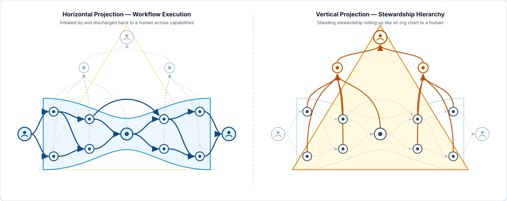

# Constellation

**An open architecture for AI & service orchestration, governance, and accountability.**

---

## Why Constellation Exists

The prevailing industry position on AI governance is that *"AI cannot be accountable—only humans can be accountable."* While well-intentioned, treating accountability as a flat property attached to a single human—and relying on RACI-style splits between "Accountable" and "Responsible"—creates a structural blind spot.

In practice, **"responsibility" is a convenient shorthand used to omit the rest of an accountability chain.** When Person A ("Accountable") and Person B ("Responsible") leave a project meeting, B is in fact *accountable to A* for delivering their scope, and B's team members are *accountable to B*. Accountability has always been a **chain**, and it has always operated along **two independent axes at once**:

1. **The Workflow Chain (Horizontal):** Who is accountable for completing *this specific request*—transferring custody (for example, a Tier 1 technician handing a ticket to Tier 2) or subcontracting a specialized step while remaining accountable for the overall outcome.
2. **The Stewardship Chain (Vertical):** Who is accountable for ensuring *the capability itself* remains healthy, accurate, well-documented, and governed over time—rolling up like an org chart from a service steward through management, the CIO, and the CEO.

Once we stop pretending accountability is a single cell on a chart and model it honestly as a two-axis chain, the barrier to governing AI disappears: **AI agents and services *must* hold accountability as intermediate links in both workflow and stewardship chains—under the strict rule that every chain must exit the system and terminate at a named human.**

Furthermore, as AI commoditizes the speed of generating insight, the bottleneck shifts to the speed of *acting* on it. Most organizations move slowly day-to-day because decision rights sit in static policy binders while nobody knows who can approve what in practice.

---

## Why Constellation?

Unlike 2010s microservice architectures—which were a voluntary engineering decision to split one application into tiny pieces—today's proliferation of AI agents, scripts, webhooks, and services is happening whether central IT plans for it or not.

Constellation gives you a way to orchestrate and govern that reality without slowing it down:

- **Radically Simple:** Built from just **two primitives** (`Entity` and `Contract`) and **two mandatory records** (a slow-changing `Enrolment Ledger` and a fast-changing `Contract Journal`). Everything else is optional.
- **Scale-Agnostic:** An entity in Constellation doesn't have to be a microservice. It can be a twenty-line script, an autonomous AI agent, a legacy enterprise monolith, or even an external vendor's black-box system (such as an equipment OEM's predictive-maintenance model collaborating across an organizational boundary without either party surrendering its IP).
- **One Model for Governance & Execution:** By modeling interactions and ownership as chains of contracts, Constellation addresses **accountability, governance, runtime orchestration, decision rights, access control, auditability, and origin/identity assurance** through a single unified mechanism—and generates **comprehensible projections** so the humans at the end of every chain can genuinely understand what happened under their name.
- **Your Domain, Your Flavour:** Constellation defines the primitives and invariants, never the products. You define your own **Domain Declaration** to make it whatever flavour fits your environment—from a lightweight self-hosted setup to a full enterprise stack integrated with your existing identity providers, event buses, and data catalogs.
- **100% Open Source:** Free to adopt, implement, and extend.

---

## How Do I Build It?

Read the specification:

- **[`SPECIFICATION.md`](./SPECIFICATION.md)** — The Constellation Architecture Specification (`v0.1`).

---

## License

Copyright © 2026 Brian Spackman.

- **Specification prose and architectural diagrams:** Licensed under [CC BY 4.0](./LICENSE-CC-BY-4.0) (attribution to **Brian Spackman**).
- **Schemas, protocol mechanics, and reference code:** Licensed under [Apache License 2.0](./LICENSE-APACHE).

## Provenance

Conceived and architected by Brian Spackman; distilled with Gemini 4 Argon (`google/gemini-4-argon`) and reviewed for RFC clarity with Claude Opus 4.8 (`claude-opus-4-8`), 2026-10-28.
